<div align="center">

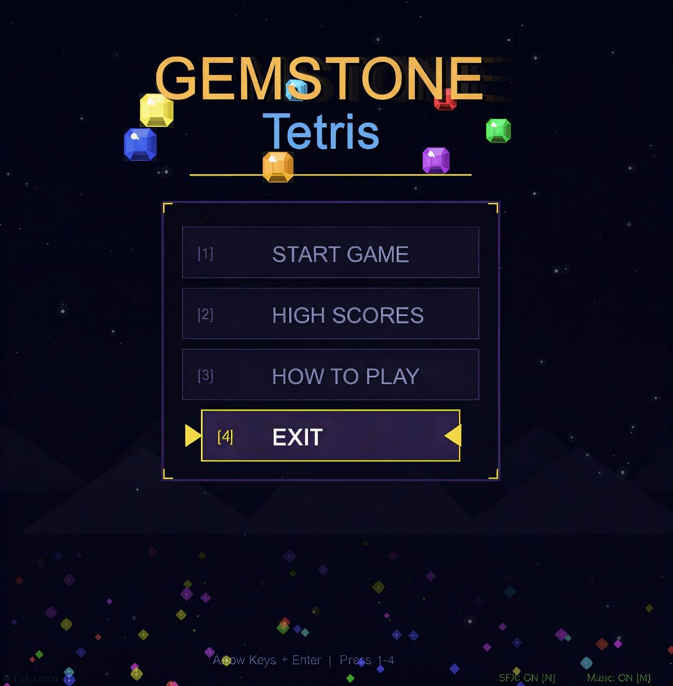

# 💎 Gemstone Guardian

### A Jewel-Themed Tetris Experience · ICAT Project

**C++ · SFML · Spring 2026**


</div>

| | |
|---|---|
| **University** | National University of Technology (NUTECH), Main I.J.P Road, Sector I-12, Islamabad |
| **Department** | Computer Science |
| **Semester** | Spring 2026 |
| **Program** | BS Computer Science |
| **Section** | CS-25 B |
| **Programming Language** | C++ |
| **Date** | February 16, 2026 |

### 👥 Submitted By

| Name | Registration No. |
|---|---|
| Abdul Rafay Akhtar | F25605217 |
| Hina Waheed Cheema | F25605226 |
| Madeeha | F25605206 |
| Amna Zahid | F25605247 |
| Urba Usman | F25605245 |

### 👨‍🏫 Submitted To

| Name | Role |
|---|---|
| Mr. Saad Rafi Butt | Teacher |

---

## 📑 Table of Contents

1. [Introduction](#1-introduction)
2. [Objectives](#2-objectives)
3. [Concepts Used](#3-concepts-used)
4. [Requirements](#4-requirements)
5. [Game Functionality](#5-game-functionality)
6. [Controls](#6-controls)
7. [How to Play](#7-how-to-play)
8. [System Requirements](#8-system-requirements)
9. [Installation & How to Run](#9-installation--how-to-run)
10. [Scope of Project](#10-scope-of-project)
11. [Algorithms](#11-algorithms)
12. [Implementation Details](#12-implementation-details)
13. [Sample Output](#13-sample-output)
14. [Conclusion](#14-conclusion)
15. [Future Enhancements](#15-future-enhancements)
16. [License](#16-license)

---

## 1. Introduction

**Gemstone Guardian** is an enhanced, visually stunning implementation of the classic Tetris game, developed as part of the ICAT Project for Spring 2026. The project transforms the traditional block-stacking game into a gemstone-themed adventure with advanced graphics, particle effects, dynamic audio, and multiple gameplay modes.

Built using **C++** and **SFML** (Simple and Fast Multimedia Library), the game features intricate visual effects, responsive controls, and an engaging user interface suitable for both casual players and Tetris enthusiasts.

---

## 2. Objectives

1. To create an engaging and visually appealing Tetris game with modern graphics and effects.
2. To implement advanced features such as particle systems, animated backgrounds, and dynamic lighting.
3. To provide multiple difficulty levels catering to both beginners and advanced players.
4. To develop a robust scoring system with combos and special rules.
5. To ensure cross-platform compatibility (Windows, macOS, Linux).
6. To create an intuitive user interface with multiple menu systems.
7. To implement high score tracking and persistence.
8. To provide configurable audio with background music and sound effects.
9. To optimize performance for smooth gameplay even with extensive visual effects.
10. To document the development process for educational purposes.

---

## 3. Concepts Used

| # | Concept | Where / How |
|---|---|---|
| 1 | **Object-Oriented Programming (OOP)** | Classes for `Game`, `Tetris`, `ParticleSystem`, `Particle`, `FloatingText`, `ScreenTransition`, `StarField` |
| 2 | **Game State Management** | Finite state machine for menu, playing, paused, and game over states |
| 3 | **Collision Detection** | Boundary checking and block collision detection |
| 4 | **Particle Systems** | Dynamic particle generation and rendering for visual effects |
| 5 | **2D Graphics Rendering** | Sprite-free rendering using SFML primitive shapes |
| 6 | **Audio Programming** | Background music and sound effect management |
| 7 | **File I/O** | High score saving and loading from text files |
| 8 | **Event-Driven Programming** | Keyboard input handling and window events |
| 9 | **Animation Systems** | Frame-based and time-based animations |
| 10 | **Memory Management** | Efficient particle system with automatic cleanup |
| 11 | **Algorithm Design** | Line clearing, piece rotation logic, scoring algorithms |
| 12 | **UI/UX Design** | Menu navigation, visual feedback, and user interaction |

---

## 4. Requirements

### Technical Requirements

- **Programming Language:** C++17 or higher
- **Graphics Library:** SFML 2.5.1+ (or 3.0.2-1)
- **Compiler:** GCC 7+, Clang 6+, or MSVC 2019+
- **Build System:** CMake 3.10+ or manual compilation
- **Audio Formats:** OGG or WAV for sound files
- **Font:** TrueType font file (Arial or equivalent)

### Development Requirements

- **IDE:** Visual Studio Code, Visual Studio, or a compatible IDE
- **Version Control:** Git (optional)
- **Documentation:** Markdown support for README

### Asset Requirements

- **Audio Files:** 5 OGG/WAV files for music and sound effects
- **Font File:** 1 TrueType font file
- **No external image files required** (all graphics are procedurally generated)

---

## 5. Game Functionality

### Core Gameplay

1. **Block Falling:** Tetrimino pieces fall from the top of the playfield.
2. **Rotation:** Pieces can be rotated clockwise.
3. **Movement:** Horizontal movement with boundary checking.
4. **Line Clearing:** Complete horizontal lines are removed.
5. **Speed Progression:** Game speed increases with level.
6. **Game Over:** Game ends when blocks stack to the top.

### Advanced Features

1. **Hold System:** Store a piece for later use.
2. **Ghost Piece:** Preview where the current piece will land.
3. **Next Pieces:** Display the next three upcoming pieces.
4. **Hard Drop:** Instant placement of the current piece.
5. **Soft Drop:** Accelerated falling while holding the down key.
6. **Combo System:** Bonus points for consecutive line clears.
7. **Struggle Rule:** Bottom row freezes if no lines are cleared for 5 minutes.
8. **Difficulty Levels:** Beginner (4 piece types) and Advanced (7 piece types).

### Visual Effects

1. **Particle Explosions:** During line clears and game over.
2. **Jewel Sparkles:** Random sparkle effects on placed blocks.
3. **Screen Shake:** Impact effects for significant events.
4. **Floating Text:** Animated score and combo indicators.
5. **Background Animation:** Twinkling stars with depth effect.
6. **Transition Effects:** Smooth screen transitions between states.
7. **Glow Effects:** Highlighted pieces and selected menu items.

### Audio Features

1. **Background Music:** Separate tracks for menu and gameplay.
2. **Sound Effects:** Movement, rotation, drop, and clear sounds.
3. **Volume Control:** Independent toggles for music and SFX.
4. **Audio Feedback:** Confirmation sounds for user actions.

---

## 6. Controls

### In-Game Controls

| Key | Action | Description |
|---|---|---|
| `←` `→` | Move Left/Right | Move Tetrimino horizontally |
| `↑` | Rotate | Rotate piece clockwise (90°) |
| `↓` | Soft Drop | Accelerate piece descent |
| `Space` | Hard Drop | Instantly place piece at the bottom |
| `C` | Hold Piece | Store current piece for later use |
| `P` / `ESC` | Pause Game | Pause/resume gameplay |
| `M` | Toggle Music | Turn background music on/off |
| `N` | Toggle SFX | Turn sound effects on/off |
| `F11` / `F` | Fullscreen | Toggle fullscreen mode |

### Menu Navigation

| Key | Action | Description |
|---|---|---|
| `↑` `↓` | Navigate | Move between menu options |
| `←` `→` | Select | Choose difficulty options |
| `Enter` | Confirm | Select highlighted option |
| `Space` | Confirm | Alternative selection key |
| `1`–`4` | Quick Select | Direct menu item selection |
| `ESC` | Back | Return to previous screen |
| `B` / `1` | Beginner | Select beginner difficulty |
| `A` / `2` | Advanced | Select advanced difficulty |

### Control Details

- **Movement:** Instant response with no acceleration.
- **Rotation:** Wall kick implementation for edge rotation.
- **Soft Drop:** Increases fall speed while the key is pressed.
- **Hard Drop:** Calculates and applies instant placement.
- **Hold:** One-time use per piece placement.
- **Pause:** Freezes game state with an overlay menu.

---

## 7. How to Play

### Basic Rules

1. **Objective:** Arrange falling Tetrimino pieces to complete horizontal lines.
2. **Line Clearing:** When a line is completely filled, it disappears.
3. **Scoring:** Points are awarded based on lines cleared and the current level.
4. **Level Progression:** Game speed increases every 10 lines cleared.
5. **Game End:** The game ends when new pieces cannot enter the playfield.

### Scoring Table

| Lines Cleared | Points |
|---|---|
| 1 Line | 10 × Level |
| 2 Lines | 30 × Level |
| 3 Lines | 60 × Level |
| 4 Lines (**TETRIS!**) | 100 × Level |

### Strategy Tips

1. **Plan Ahead:** Use the "Next" and "Hold" features to plan piece placement.
2. **Create Gaps:** Leave spaces for the I-piece to clear four lines (Tetris).
3. **Manage Height:** Keep the stack low to avoid game over.
4. **Use Rotation:** Rotate pieces to fit into available spaces.
5. **Clear Regularly:** Avoid triggering the Struggle Rule by clearing lines often.
6. **Combo Chains:** Clear multiple lines consecutively for bonus points.

### Difficulty Differences

| | 🟢 Beginner Mode | 🔴 Advanced Mode |
|---|---|---|
| **Pieces** | Only I, O, T, and L | All 7 classic Tetriminos (I, Z, S, T, L, J, O) |
| **Initial Speed** | Slower (0.5 s delay) | Faster (0.35 s delay) |
| **Rotation** | Simpler collision detection | Standard Tetris rotation with wall kicks |
| **Ideal For** | New players learning the mechanics | Experienced players seeking a challenge |

### Special Rules

**⚠️ Struggle Rule**

- **Trigger:** No lines cleared for 5 minutes.
- **Effect:** The bottom row becomes permanently frozen.
- **Visual:** A red warning appears in the stats panel.
- **Strategy:** Forces players to maintain active gameplay.

**🔥 Combo System**

- **Bonus:** +5 × Level points per combo multiplier.
- **Reset:** Broken by failing to clear lines.
- **Display:** Animated combo counter during play.
- **Maximum:** Unlimited potential combos.

### 💎 Gem Types

Aquamarine · Ruby · Emerald · Amethyst · Topaz · Sapphire · Citrine

---

## 8. System Requirements

| | Minimum | Recommended |
|---|---|---|
| **OS** | Windows 7 SP1 (64-bit) or newer; macOS 10.12 Sierra or newer; Linux with X11 and OpenGL support | Windows 10/11 (64-bit); macOS 11 Big Sur or newer; Ubuntu 20.04 LTS or equivalent |
| **Processor** | 1.5 GHz dual-core CPU | 2.0 GHz quad-core CPU |
| **Memory** | 4 GB RAM | 4 GB RAM |
| **Graphics** | OpenGL 2.0 compatible GPU, 256 MB VRAM, 1280×720 support | OpenGL 3.0 compatible GPU, 512 MB VRAM, 1920×1080 support |
| **Storage** | 100 MB available | 150 MB available (assets and high scores) |
| **Audio** | DirectSound compatible sound card | Stereo sound system or headphones |

---

## 9. Installation & How to Run

### 9.1 Get the Project

```bash
git clone <your-repository-url>
cd <your-repository-folder>
```

Or download the ZIP from GitHub and extract it.

The game expects this layout (the font and audio files must sit **next to the source file**):

```
tetris/
└── tetris/
    ├── Tetris.cpp
    ├── arial.ttf
    ├── menu_music.ogg
    ├── game_music.ogg
    ├── arrows_music.ogg
    ├── spacebar_music.ogg
    ├── gameover_music.ogg
    └── Play Game.bat          # Windows quick-play launcher
```

### 9.2 Step 1: Install Dependencies (SFML)

#### 🪟 Windows

**Method 1: vcpkg (recommended for Visual Studio)**

```bat
git clone https://github.com/Microsoft/vcpkg.git
cd vcpkg
.\bootstrap-vcpkg.bat
.\vcpkg integrate install
.\vcpkg install sfml:x64-windows
```

**Method 2: Manual installation**

1. Download SFML from <https://www.sfml-dev.org/download.php>.
2. Extract it to `C:\SFML`.
3. Add `C:\SFML\bin` to your `PATH`.

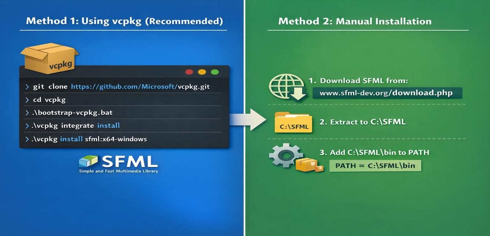

> The recommended route for **VS Code** users is MSYS2. See [9.4](#94-windows--vs-code-step-by-step-msys2) below.

#### 🍎 macOS

```bash
brew update
brew install sfml
brew info sfml      # verify installation
```

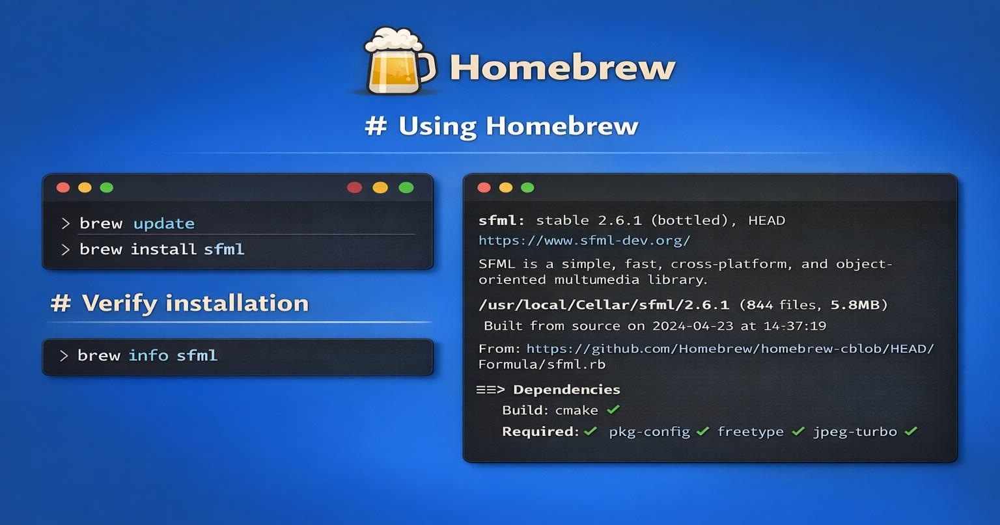

#### 🐧 Linux (Ubuntu / Debian)

```bash
sudo apt update
sudo apt install build-essential cmake libsfml-dev
```

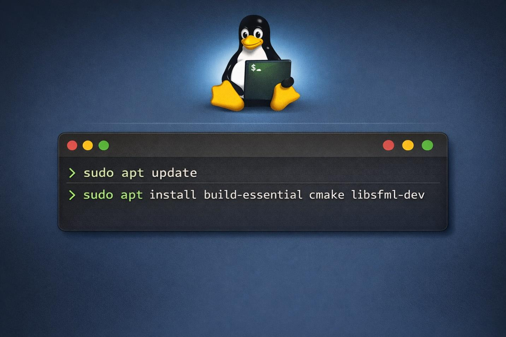

### 9.3 Step 2: Set Up Assets

- Place `arial.ttf` in `tetris/tetris/`.
- Place these audio files in `tetris/tetris/`:
  - `menu_music.ogg`
  - `game_music.ogg`
  - `arrows_music.ogg`
  - `spacebar_music.ogg`
  - `gameover_music.ogg`

### 9.4 Windows + VS Code Step-by-Step (MSYS2)

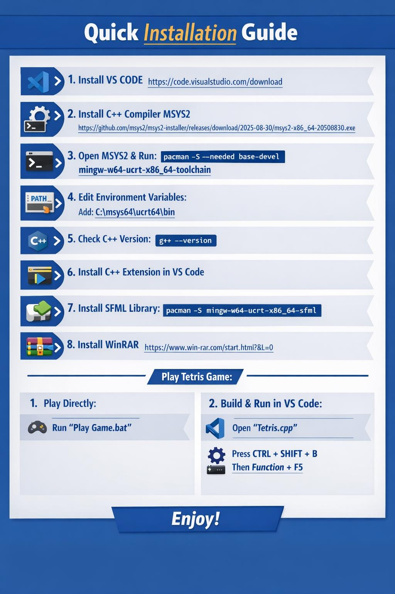

1. **Install VS Code:** <https://code.visualstudio.com/download>
2. **Install the C++ compiler (MSYS2):** download the installer from <https://www.msys2.org/>.
3. **Open the MSYS2 terminal and run:**
   ```bash
   pacman -S --needed base-devel mingw-w64-ucrt-x86_64-toolchain
   ```
4. **Edit Environment Variables:** add `C:\msys64\ucrt64\bin` to your `PATH`.
5. **Check the compiler version** (in a new Command Prompt):
   ```bat
   g++ --version
   ```
6. **Install the C++ extension** in VS Code. Optional extras: "Night Owl" theme and an icon pack.
7. **Install the SFML library** in the MSYS2 terminal:
   ```bash
   pacman -S mingw-w64-ucrt-x86_64-sfml
   ```
8. **Install WinRAR** (to extract archives): <https://www.win-rar.com/start.html?&L=0>

### 9.5 Step 3: Build & Run

#### ▶️ Option A: Quick Play (Windows)

Double-click **`Play Game.bat`**.

#### ▶️ Option B: Build & Run in VS Code

1. Open VS Code → **File → Open Folder…** and choose your game folder.
2. Open **`Tetris.cpp`**.
3. Press **`Ctrl + Shift + B`** to build. Wait until the tick mark ✔ appears.
4. Press **`Fn + F5`** (or just `F5`) to run.
5. The game is running. Enjoy! 🎮

#### ▶️ Option C: Command Line

> Run from the folder that contains `Tetris.cpp`, `arial.ttf`, and the `.ogg` files, because the game loads them by relative path.

**Windows (MSYS2 UCRT64 terminal) / Linux:**

```bash
g++ -std=c++17 -O2 Tetris.cpp -o Tetris -lsfml-graphics -lsfml-window -lsfml-system -lsfml-audio
./Tetris
```

**macOS (Homebrew):**

```bash
clang++ -std=c++17 -O2 Tetris.cpp -o Tetris \
  -I$(brew --prefix sfml)/include -L$(brew --prefix sfml)/lib \
  -lsfml-graphics -lsfml-window -lsfml-system -lsfml-audio
./Tetris
```

#### ▶️ Option D: CMake

Create a `CMakeLists.txt` next to `Tetris.cpp`:

```cmake
cmake_minimum_required(VERSION 3.10)
project(GemstoneGuardian CXX)
set(CMAKE_CXX_STANDARD 17)
set(CMAKE_CXX_STANDARD_REQUIRED ON)

find_package(SFML 2.5 COMPONENTS graphics window system audio REQUIRED)

add_executable(Tetris Tetris.cpp)
target_link_libraries(Tetris sfml-graphics sfml-window sfml-system sfml-audio)

# copy font and audio next to the executable
file(GLOB ASSETS "${CMAKE_SOURCE_DIR}/*.ogg" "${CMAKE_SOURCE_DIR}/*.ttf")
file(COPY ${ASSETS} DESTINATION ${CMAKE_BINARY_DIR})
```

```bash
mkdir build && cd build
cmake ..
cmake --build .
./Tetris
```

> If you installed **SFML 3**, use `find_package(SFML 3 COMPONENTS Graphics Window System Audio REQUIRED)` and link `SFML::Graphics SFML::Window SFML::System SFML::Audio` instead. SFML 2 and SFML 3 have different APIs, so build with the version the code was written for.

### 9.6 Troubleshooting

| Problem | Fix |
|---|---|
| `g++ is not recognized` | Add `C:\msys64\ucrt64\bin` to `PATH`, then reopen the terminal / VS Code. |
| `fatal error: SFML/Graphics.hpp: No such file` | SFML is not installed for the compiler you are using. Reinstall with `pacman -S mingw-w64-ucrt-x86_64-sfml` (Windows) or `libsfml-dev` (Linux). |
| `sfml-audio-2.dll` / `openal32.dll` not found | Add `C:\msys64\ucrt64\bin` to `PATH`, or copy the DLLs next to the `.exe`. |
| Game opens but text is missing | `arial.ttf` is not in the same folder as the executable. |
| No music or sound | Audio files are missing or have different names. Check the 5 `.ogg` names in [9.3](#93-step-2-set-up-assets). |
| Compile errors about `sf::VideoMode`, `sf::Event`, etc. | SFML version mismatch (2.x vs 3.x). Install the version the code targets. |
| Black or blank window on Linux / VM | OpenGL is unavailable. Run on a real desktop session with GPU drivers. |

---

## 10. Scope of Project

### Functional Scope: Included Features

1. **Complete Tetris Gameplay:** all core Tetris mechanics
2. **Multiple Difficulty Levels:** Beginner and Advanced modes
3. **Visual Effects System:** particle effects, animations, and transitions
4. **Audio System:** background music and sound effects
5. **High Score System:** persistent score tracking
6. **Menu System:** multiple screens and navigation
7. **Configuration Options:** audio toggles, fullscreen mode
8. **Cross-Platform Support:** Windows, macOS, Linux compatibility

### Technical Scope

1. **Codebase Size:** ~3530 lines of C++ code
2. **Library Dependencies:** SFML only (no additional libraries)
3. **Asset Requirements:** minimal external assets (font + audio)
4. **Performance Targets:** 60 FPS on recommended hardware
5. **Memory Usage:** < 100 MB during gameplay
6. **File I/O:** only for high scores (no complex file management)

### Limitations

1. **No Network Play:** single-player only
2. **No Customization:** fixed color schemes and themes
3. **Limited Resolution Support:** fixed aspect ratio
4. **No Save/Load:** no mid-game save functionality
5. **No Replays:** cannot replay previous games
6. **Fixed Difficulty Settings:** only two predefined modes

---

## 11. Algorithms

### Core Game Algorithms

#### 1. Tetrimino Rotation Algorithm

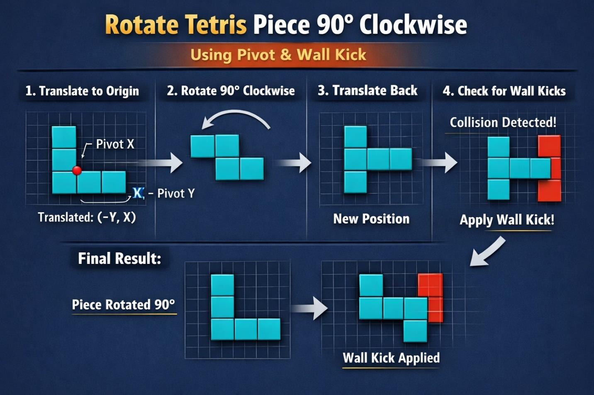

#### 2. Line Detection Algorithm

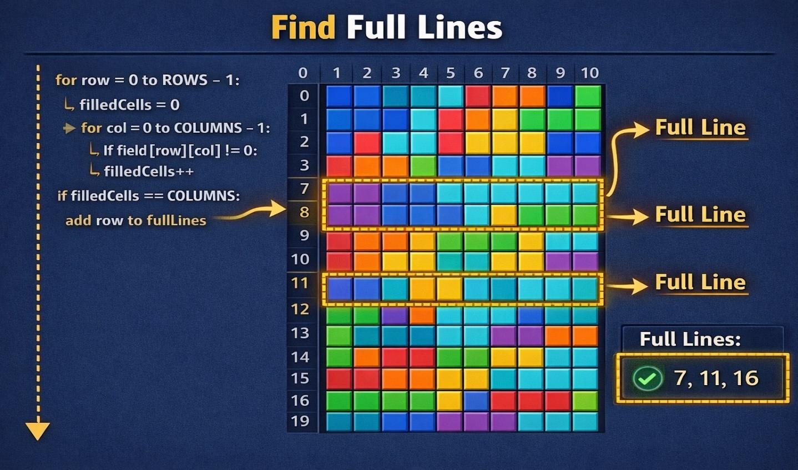

#### 3. Line Clearing Algorithm

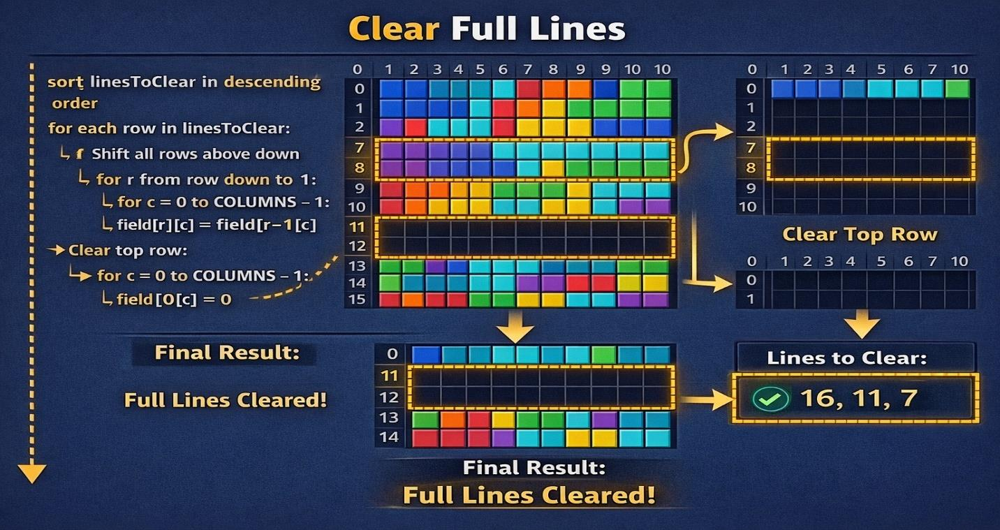

#### 4. Collision Detection Algorithm

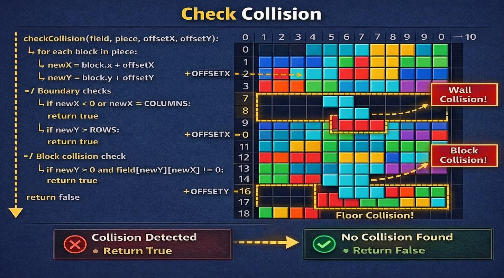

#### 5. Ghost Piece Calculation

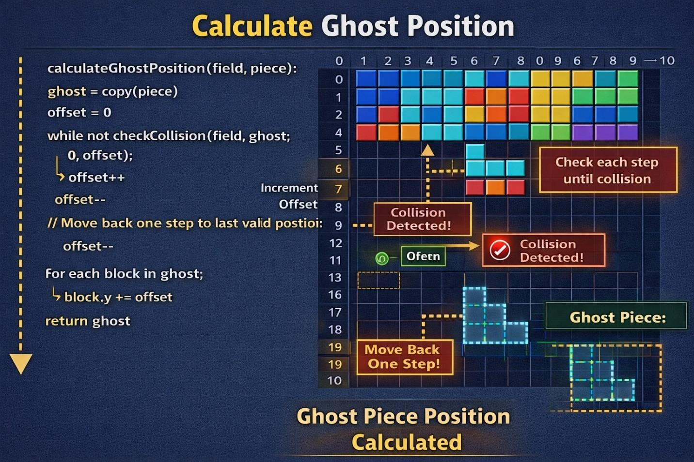

#### 6. Particle Update Algorithm

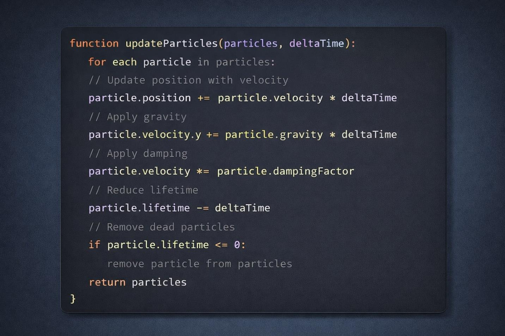

---

## 12. Implementation Details

### Class Architecture

#### 1. `Game` Class (Main Controller)

- **Purpose:** Overall game management and state handling
- **Responsibilities:**
  - Game state transitions (Menu → Playing → Game Over)
  - Input handling and event processing
  - Resource management (audio, fonts)
  - Rendering coordination
  - High score management
- **Key Methods:**
  - `run()`: main game loop
  - `processEvents()`: handle user input
  - `update()`: update game logic
  - `render()`: draw everything to the screen

#### 2. `Tetris` Class (Game Logic)

- **Purpose:** Core Tetris game mechanics
- **Responsibilities:** piece generation and movement, collision detection, line clearing logic, scoring calculations, difficulty management
- **Key Data Structures:**
  - `field[ROWS][COLUMNS]`: game board state
  - `figures[7][4]`: piece definitions
  - `actPosition[4]`: current piece position

#### 3. `ParticleSystem` Class (Visual Effects)

- **Purpose:** Manage particle effects
- **Responsibilities:** particle creation and updating, effect types (explosions, sparkles, fire), memory management and cleanup, particle rendering
- **Key Features:**
  - Maximum 3000 particles
  - 5 particle types (gem, circle, cross, mist, custom)
  - Gravity and damping simulation

#### 4. `StarField` Class (Background)

- **Purpose:** Animated starry background
- **Responsibilities:** star generation with random properties, twinkle animation, depth simulation, color variation
- **Key Features:**
  - 150 stars with individual properties
  - Depth-based alpha blending
  - Animated twinkle effects

#### 5. `ScreenTransition` Class (UI Effects)

- **Purpose:** Smooth screen transitions
- **Responsibilities:** fade-in/fade-out effects, transition timing, overlay rendering
- **Key Features:**
  - Configurable duration
  - Fade direction control
  - Progress tracking

### Memory Management

**Particle System Optimization**

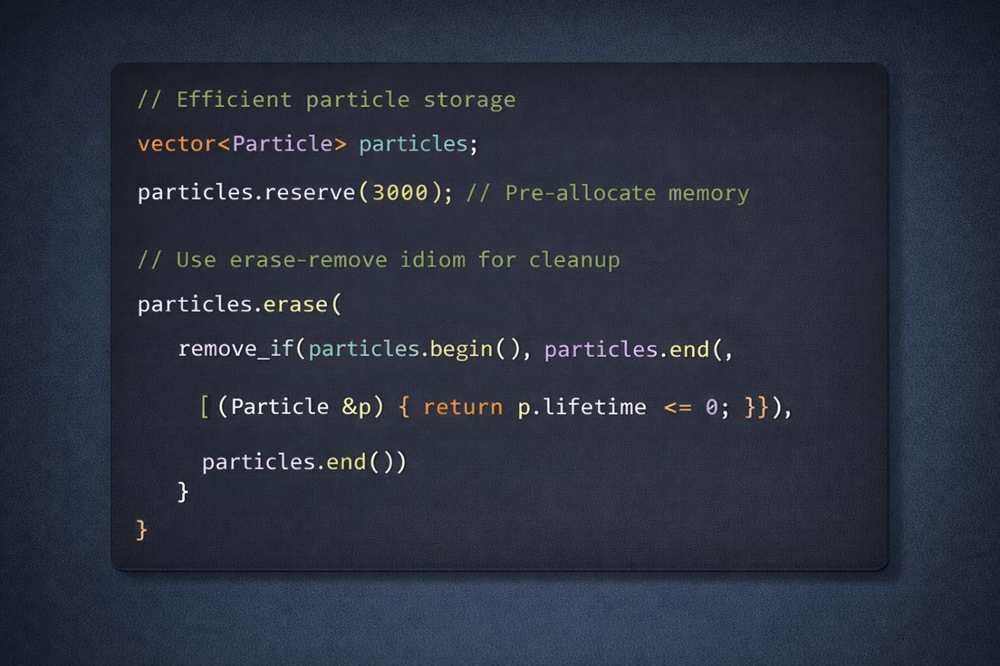

**Game State Management**

- Stack-based state transitions
- No dynamic allocation during gameplay
- Fixed-size arrays for the game board
- RAII for resource management

### Rendering Pipeline

1. **Background:** sky gradient and mountains
2. **Stars:** animated starfield
3. **Game Board:** grid and placed blocks
4. **Active Pieces:** current and ghost pieces
5. **UI Elements:** panels, text, buttons
6. **Particles:** overlay effects
7. **Transitions:** screen fade overlays
8. **Floating Text:** animated score popups

### Audio System Architecture

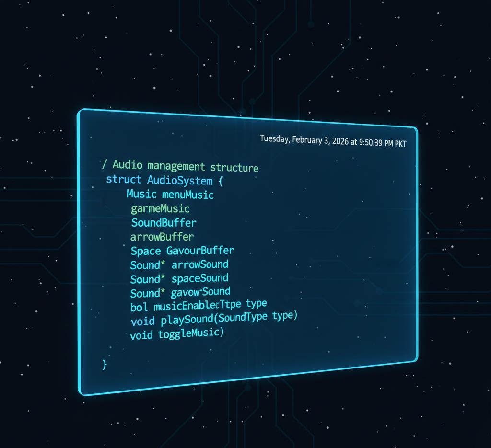

---

## 13. Sample Output

### Main Menu


### How To Play Screen

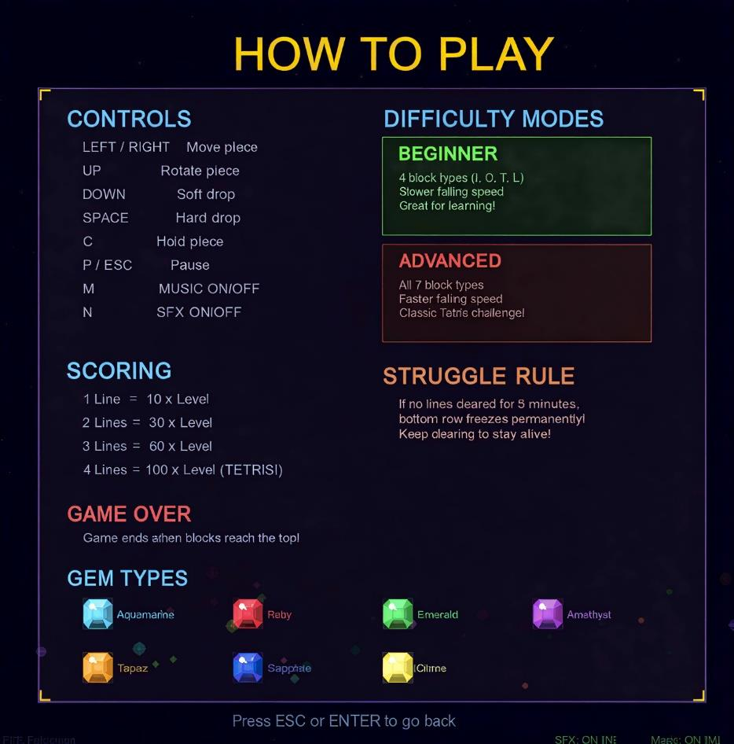

### High Scores

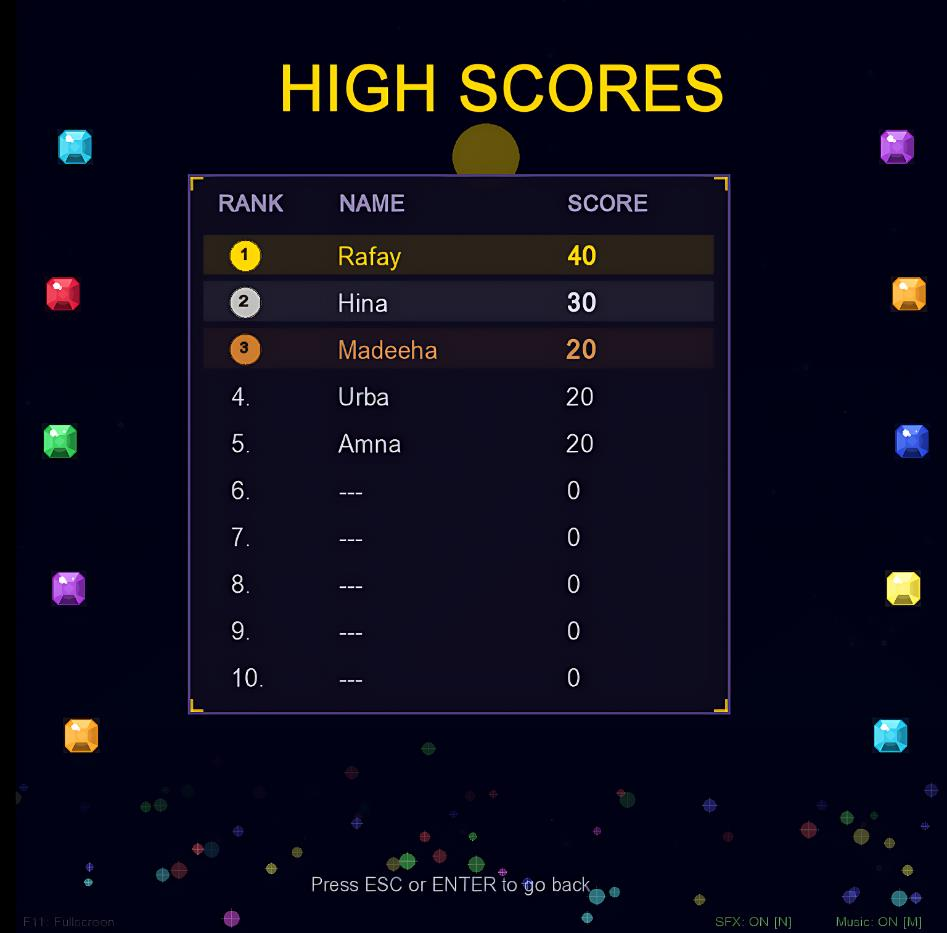

### Select Difficulty

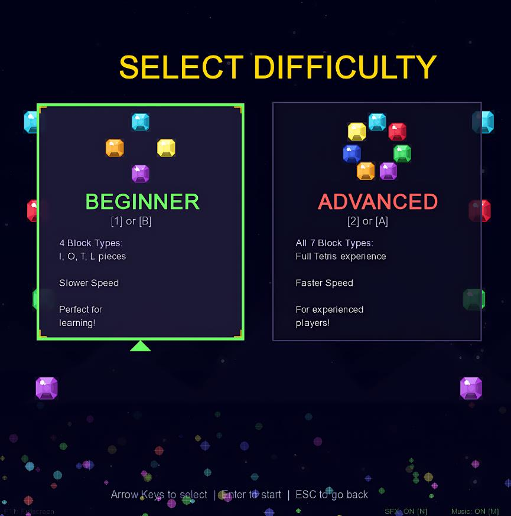

### Gameplay

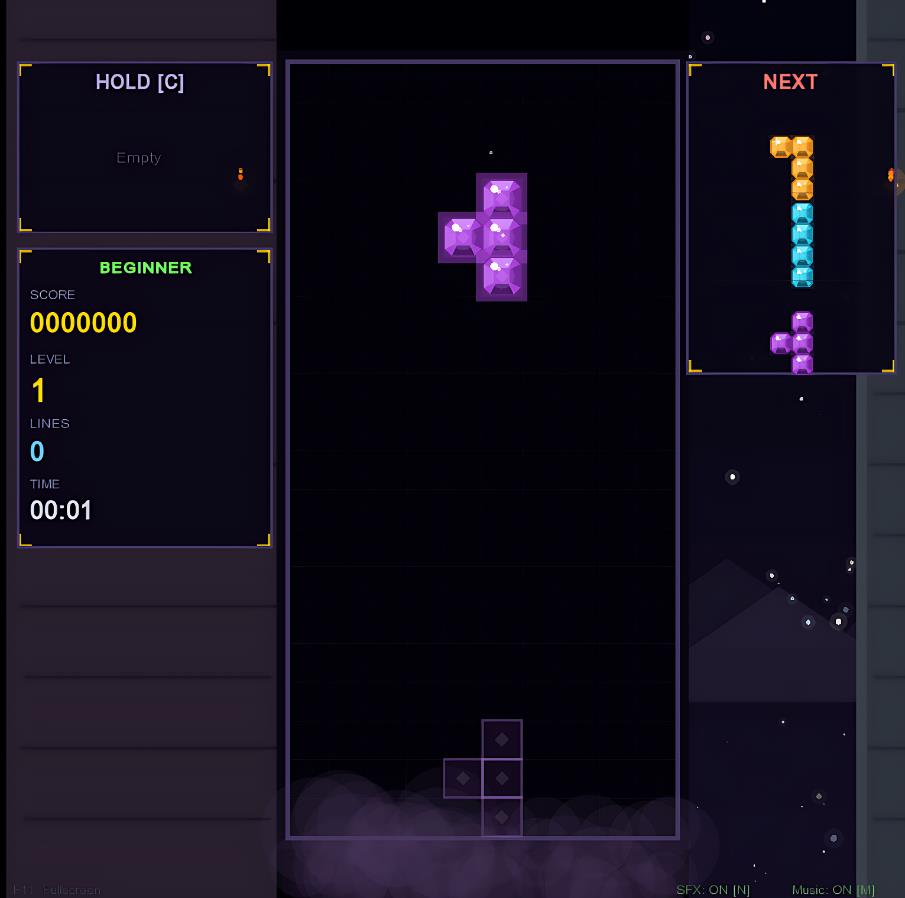

---

## 14. Conclusion

Gemstone Guardian successfully achieves its objectives of creating an engaging, visually stunning Tetris experience with modern features.

### Achievements

1. **Complete Game Implementation:** all core Tetris mechanics with advanced features
2. **Visual Excellence:** impressive particle effects and animations without external assets
3. **Audio Integration:** comprehensive sound system with configurable options
4. **User-Friendly Interface:** intuitive menus and clear visual feedback
5. **Performance Optimization:** smooth 60 FPS gameplay with extensive effects
6. **Cross-Platform Compatibility:** working builds for Windows, macOS, and Linux
7. **Educational Value:** well-documented code suitable for learning game development

### Technical Successes

1. **Efficient Particle System:** handles up to 3000 particles without performance issues
2. **Robust Collision Detection:** accurate piece movement and rotation
3. **State Management:** clean transitions between game states
4. **Resource Management:** proper loading and cleanup of audio/font resources
5. **Code Organization:** modular architecture with clear separation of concerns

### Learning Outcomes

1. **SFML Mastery:** comprehensive understanding of SFML graphics, audio, and window management
2. **Game Architecture:** experience with game loop design and state machines
3. **Performance Optimization:** techniques for maintaining frame rate with complex effects
4. **Cross-Platform Development:** handling platform-specific considerations
5. **Project Management:** complete development cycle from concept to implementation

---

## 15. Future Enhancements

| Area | Planned Features |
|---|---|
| 🎮 **Gameplay** | Multiplayer mode (local or online), challenge modes (time trial, marathon, sprint), power-ups with special blocks, achievement system, custom rules |
| 🎨 **Visuals** | Multiple themes (seasons, holidays), customizable gem colors, GLSL shaders, optional 3D perspective, more complex piece entry/clear animations |
| 🧭 **Interface** | Settings menu, replay system, statistics tracking, interactive tutorial mode, multiple language support |
| ⚙️ **Technical** | Network play with online leaderboards, save system with multiple slots/profiles, mod support, VR/AR mode |

---

## 16. License

This project was created for **educational purposes** as part of the ICAT Project, Spring 2026.

---

<div align="center">

**THE END**

Made with ☕ and C++ at the National University of Technology (NUTECH), Spring 2026

</div>
